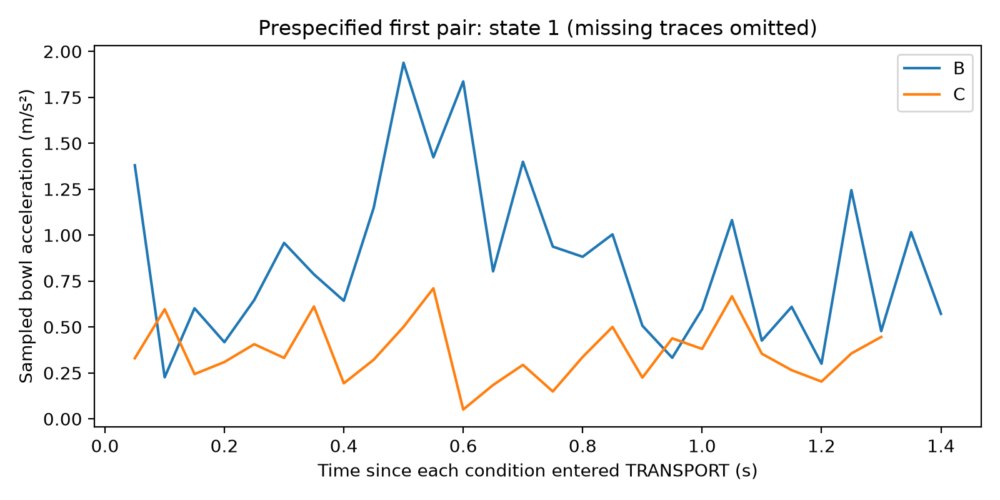
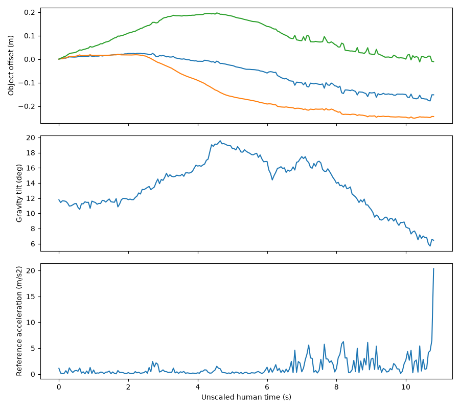
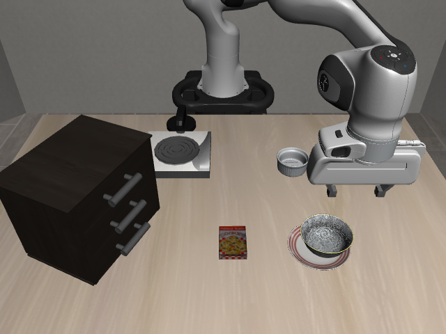

# Pick and place without spilling

**I developed a method that uses phone-recorded human demonstrations to adapt robot movement to task-specific constraints.**

A phone and printed markers make collecting movement data simple and inexpensive. The aim is to use that data to adjust how a robot carries out a task with specific constraints. This could be useful when object orientation and acceleration matter: carrying open containers, keeping samples upright, or assembling components that require specific orientation.

I tested the idea by adding a “do not spill” constraint to a bowl-to-plate task. I used a human demonstration to set acceleration and tilt limits, then applied these to a pretrained robot model during carrying. Acceleration fell, while tilt changed little because the original movement already kept the bowl reasonably upright. Repeated tests showed fewer successful placements, so the remaining challenge is to adapt the movement while still completing the task reliably.

## Human guidance reduced a measure of spill risk

The goal is to carry the bowl without spilling, acceleration and tilt were used as measurable proxies for that goal. Sudden changes in movement can disturb the liquid, while tilting the bowl can bring it closer to spilling over the rim.

I compared three cases on a bowl-to-plate task in LIBERO:

| Test case | Instruction and guidance | Task success | Maximum bowl acceleration | Maximum bowl tilt |
|---|---|---|---:|---:|
| **A — Original task** | Pick up the bowl and place it on the plate | Yes | 2.3 m/s² | 13° |
| **B — Liquid instruction** | Same task, with “the bowl is full of liquid, do not spill it” | Yes | 2.1 m/s² | 14° |
| **C — Human guidance** | Liquid instruction plus acceleration and tilt limits from the phone demonstration | Yes | 0.63 m/s² | 14° |

### Matched robot runs

https://github.com/user-attachments/assets/b0865b5a-45b4-4e3d-8105-54bc25475e28

https://github.com/user-attachments/assets/682110dd-8835-479c-881f-53b95f7e3a8f

*B: liquid instruction only. C: the same instruction with phone-derived movement limits. Both runs complete placement.*

In the matched B/C comparison, human guidance reduced maximum sampled acceleration by **69%**, suggesting less abrupt movement that could disturb the liquid. Tilt changed little: the original movement already kept the bowl reasonably upright and within the tilt allowance derived from the demonstration.

A provides context; its controller settings differ from the matched B/C runs. Each case above represents one run. Figures are rounded to two significant figures.

### Bowl motion during carrying



### Repeated tests confirmed the acceleration reduction, with lower task success

I then compared B and C across five additional starting states, using the same model and shared controller settings for each pair.

| Metric | B — Liquid instruction | C — Human guidance |
|---|---:|---:|
| LIBERO task success | 4/5 | 2/5 |
| Successful placement after release | 4/5 | 1/5 |
| Full controller sequence completed | 4/5 | 1/5 |
| Mean maximum bowl acceleration | 1.9 m/s² | 0.65 m/s² |
| Mean maximum bowl tilt | 10° | 9.9° |

C reduced acceleration in all four pairs that reached carrying, with a **66% reduction in the mean maximum**. Tilt remained similar, consistent with the original movement already being within the demonstration-derived allowance. The fifth pair did not reach carrying and has no acceleration or tilt measurements.


The guidance improved the acceleration measure of spill risk, but fewer completed placements mean it has not yet achieved the full goal: careful movement and successful delivery. A longer time allowance would help test whether incomplete runs are caused by the episode deadline or by problems with placement.

[Constraint method](https://github.com/amcguire985/humanoid-internship-challenge/blob/upright-mug-orientation/docs/BOWL_PHONE_CONSTRAINTS.md) · [Matched B/C setup](https://github.com/amcguire985/humanoid-internship-challenge/blob/upright-mug-orientation/docs/BOWL_MATCHED_B.md) · [Five-pair protocol](https://github.com/amcguire985/humanoid-internship-challenge/blob/upright-mug-orientation/docs/BOWL_FINAL_MATCHED_BC.md)

## The demonstration supplies movement limits without replacing the model

I recorded myself moving a tagged object with a phone camera. Printed AprilTags on the table and object provided a fixed reference for recovering its position and orientation. I focused on object motion because hand tracking was less reliable when markers were hidden.

### Phone demonstration and recovered motion




*Recovered movement from the demonstration used by C. Label position, time, and tilt with their units wherever shown.*

The final approach uses the demonstration to set acceleration and tilt limits, rather than asking the robot to follow the video's exact path. The model still chooses the carrying direction and destination. Guidance adjusts its commands during carrying; shared controls handle grasp retention, placement, and release. The model weights are unchanged.

The acceleration limit acts on commanded movement. The results table measures the bowl's actual motion in the simulator, which can differ because of contact and robot dynamics.

[Human-motion extraction](https://github.com/amcguire985/humanoid-internship-challenge/blob/upright-mug-orientation/docs/BOWL_HUMAN_HYBRID.md) · [Phone-derived constraints](https://github.com/amcguire985/humanoid-internship-challenge/blob/upright-mug-orientation/docs/BOWL_PHONE_CONSTRAINTS.md)

## Earlier experiments established the video-to-robot process

Before testing movement limits, I adapted a recorded object path for a Panda arm and combined it with programmed grasping and placement. This completed all six tested bowl-start positions, with no retries. Path-tracking error was approximately 1.9 mm. These were scripted manipulation tests, separate from the A/B/C model comparison.



I recorded three successful runs, producing approximately 6.3 × 10³ observation–action pairs. Two small models trained on the first two runs fitted the recorded actions but failed to reproduce the task: the single-action model completed 0/2 tests, and the action-sequence model completed 0/1. This led the project towards guiding a pretrained model at execution time.

[Scripted result](results/libero_pick_place_attempt_003/README.md) · [Starting-position tests](results/libero_xy_trials_10/README.md) · [Recorded data](docs/LIBERO_ROBOT_DATASET.md) · [First learning test](results/libero_bc_baseline/README.md) · [Action-sequence test](results/libero_chunk_bc/README.md)

## What I would test next

I would first extend the time allowance for B and C without changing their controls, recording success both before and after the original deadline. This would separate timeouts from placement failures.

I would then compare movement at matched carrying durations to check whether the acceleration reduction comes from the guidance itself or simply from slower execution. A liquid simulation or physical test would be needed to assess spilling directly.

## Running the system

Use a Google Colab GPU runtime. The current experiment code is on **`upright-mug-orientation`**. No model training is needed to run the constrained controller.

### 1. Get the code and mount Drive

Run this in a Python cell:

```python
from google.colab import drive
drive.mount('/content/drive')
```

Then run this in a new cell:

```bash
%%bash
set -euo pipefail
cd /content
git clone --branch upright-mug-orientation https://github.com/amcguire985/humanoid-internship-challenge.git
cd humanoid-internship-challenge
bash config/smolvla/official_sanity_setup.bash
bash config/smolvla/official_sanity_download.bash
```

The setup scripts install the pinned Python environment, simulator dependencies, and pretrained checkpoint. If the repository is already cloned, use that checkout instead of cloning again.

### 2. Prepare the phone demonstration

The repository includes the cached marker detections and object-centre positions used by this experiment. Reconstruct the reference in a new cell:

```bash
%%bash
set -euo pipefail
cd /content/humanoid-internship-challenge
export LIBERO_CONFIG_PATH=/content/libero-official-config
bash config/smolvla/bowl_human_prepare.bash
```

This writes `reference.csv`, its metadata, and a preview plot into `MyDrive/humanoid_results/bowl_human_reference/`. Review the plot before running the robot. This route reuses recorded detections; it does not reprocess the original phone video.

### 3. Restore the experiment inputs

The C runner checks the original baseline before starting. It expects these files under `MyDrive/humanoid_results/libero_official_bowl_20261007_204110/`:

- `packages.txt`
- `sanity_manifest.json`
- `libero_spatial_2/eval_info.json`

[Download original phone recording](sha256:4a822c324e2a36160db9ce55101fe2574d04bcd620bbce6118b9e78ac2c3a068)

**These saved baseline files are an external dependency. A public download must be supplied with the submission; a code checkout alone is insufficient.** Preserve the directory layout when restoring them to Drive. They record the original checkpoint, environment, and task settings used by the experiment.

### 4. Run one phone-guided robot episode

Run the following in a new cell. The supplied file is a Colab cell, so the command removes its initial `%%bash` line before executing it:

```bash
%%bash
set -euo pipefail
cd /content/humanoid-internship-challenge
sed '1{/^%%bash$/d;}' config/smolvla/bowl_phone_constraints_colab_cell.bash | bash
```

The runner prints its output directory under `MyDrive/humanoid_results/bowl_hybrid_phone_constraints_…/C/`. Inspect task success, placement, acceleration, tilt, and the videos even if the episode fails.

### 5. Reproduce the matched comparison

The matched runner needs a fully successful C run with its original `experiment.json`, `summary.json`, and ground-truth records. Use the supplied saved C run to reproduce the reported comparison; a newly generated run may have a different outcome.

After restoring that run and setting `C_OUTPUT` to its full directory path, use:

```bash
%%bash
set -euo pipefail
cd /content/humanoid-internship-challenge
export MPLBACKEND=Agg MUJOCO_GL=egl
export LIBERO_CONFIG_PATH=/content/libero-official-config
export OPENBLAS_NUM_THREADS=1 OMP_NUM_THREADS=1 LP_NUM_THREADS=2
unset PYTHONPATH
C_OUTPUT="$(cat /content/bowl_phone_constraints_last_output.txt)"
/content/libero-official-env/bin/python scripts/run_matched_b.py --c-output "$C_OUTPUT"
```

The pointer above selects the most recent C run. Replace it with the restored successful run's path when reproducing the reported experiment. The runner verifies the match before running B.

For the five-pair experiment, use the same environment and C path, replacing the final command with:

```bash
/content/libero-official-env/bin/python scripts/run_matched_bc_batch.py \
  --c-output "$C_OUTPUT" \
  --human-reference /content/drive/MyDrive/humanoid_results/bowl_human_reference/reference.csv \
  --states 1 2 3 4 5 --excluded-states 0
```

This runs ten episodes and saves per-run results, paired comparisons, and plots. The matched runners use a frozen controller revision from Git history. These instructions have been checked against the published scripts; a clean-runtime replay has not been performed for this README revision.

## Example outputs and saved evidence

The numbered slots above mark where each video, figure, or download belongs. Replace each slot and its example code block with the actual media or link before submission.

Robot rollouts save main-camera and wrist-camera videos, bowl motion traces, acceleration and tilt plots, and JSON summaries. Use the H.264 `*_playback.mp4` copies for viewing in a browser. The five-pair runner also produces `paired_acceleration.png`, `paired_tilt.png`, `acceleration_overlay.png`, `rollouts.csv`, and `aggregate.json`.

The most useful examples for this project are:

- **Annotated phone recording:** detected markers, object axes, and the reviewed carrying interval, showing where the human data came from.
- **Matched B/C simulation clips:** the same initial state, with both runs labelled and shown at the same playback speed.
- **Acceleration and tilt traces:** aligned at carrying onset, with both conditions on the same axes.
- **Paired acceleration plot:** all four measured pairs, alongside the five-state success table above.

A successful nominal clip illustrates the method; the repeated-test results show its limitations. Keep raw CSV/JSON data with the figures so the reported values can be checked. The latest evaluation outputs currently live in Drive and still need public links in the submission.

[Video playback preparation](https://github.com/amcguire985/humanoid-internship-challenge/blob/upright-mug-orientation/docs/BOWL_VIDEO_PLAYBACK.md) · [Five-pair protocol](https://github.com/amcguire985/humanoid-internship-challenge/blob/upright-mug-orientation/docs/BOWL_FINAL_MATCHED_BC.md)
